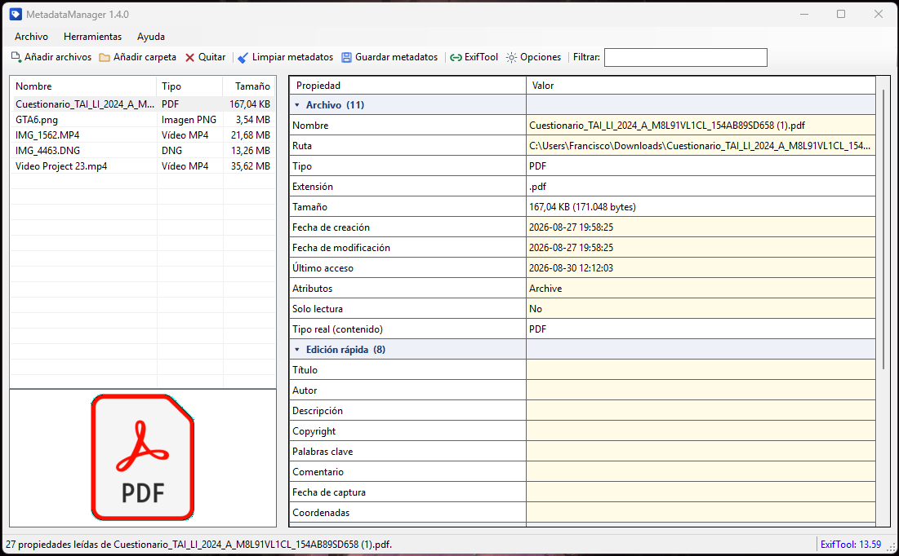

<p align="center">
  
</p>

<h1 align="center">MetadataManager</h1>

<p align="center">
  <a href="https://github.com/FranciscoFdez05/MetadataManager/releases/latest"></a>
  <a href="https://github.com/FranciscoFdez05/MetadataManager/actions/workflows/build.yml"></a>
  
  
  <a href="LICENSE"></a>
</p>

Aplicación de escritorio (WinForms, .NET 10) para **leer, editar, exportar y eliminar** los metadatos
de archivos: EXIF de fotografías, propiedades de documentos de Office y PDF, e información del
sistema de archivos.



## Características

### Lectura
- Datos del sistema de archivos, resumen (cámara, fecha de captura, resolución, coordenadas GPS) y
  volcado completo de los metadatos incrustados que reconoce
  [MetadataExtractor](https://github.com/drewnoakes/metadata-extractor-dotnet), **agrupados por
  categoría y plegables**.
- **Detección del formato real por los bytes de cabecera**, con aviso si la extensión no coincide
  con el contenido.
- **Huella SHA-256** calculada en segundo plano y cancelable.
- **Vista previa de casi cualquier archivo**: imágenes ya rotadas según su orientación EXIF,
  miniatura de Windows para PDF, Office o vídeo, primeras líneas de los archivos de texto e icono
  del tipo cuando no hay nada mejor. Los ejecutables y scripts esperan a que los autorices.
- Filtro de propiedades, orden de la lista por nombre, tipo o tamaño, y exportación individual o
  **de toda la lista en un único informe**.

### Edición
- Propiedades del sistema de archivos: **nombre, ruta completa** (renombra y mueve a otra carpeta),
  fechas de creación, modificación y último acceso, atributos y la marca de solo lectura.
- **Edición rápida**: con ExifTool conectado aparece siempre una categoría con los campos de uso
  habitual (título, autor, descripción, copyright, palabras clave, comentario, fecha de captura y
  coordenadas), **aunque el archivo no los tenga todavía**. Sirve para *añadir* metadatos a una
  imagen o un PDF que no tiene ninguno, no solo para modificar los existentes.
- **Etiquetas incrustadas** cuando ExifTool está conectado:
  - EXIF: autor, copyright, descripción, software, comentarios, marca y modelo de cámara, objetivo,
    números de serie, valoración, etiquetas XP de Windows, todas las fechas y el ISO.
  - IPTC: autor, titular, pie de foto, palabras clave, ciudad, país, crédito, fuente, instrucciones…
  - XMP: cualquier propiedad simple (`dc:title` se escribe como `XMP-dc:Title`).
  - Coordenadas GPS desde la fila «Resumen → Coordenadas», en formato `latitud, longitud`.
  - Un valor vacío **elimina** la etiqueta del archivo.
- Solo se ofrece editar lo que se puede escribir de vuelta: los valores que MetadataExtractor
  reformatea para mostrarlos (`1/125 sec`, `f/2.8`, `Top, left side`) quedan de solo lectura, porque
  devolverlos tal cual fallaría.

### Borrado de metadatos
| Formato | Alcance sin ExifTool |
| --- | --- |
| JPEG, PNG | Completo y **sin recomprimir**: se descartan los segmentos APPn/COM y los chunks auxiliares |
| PDF | Completo: diccionario `/Info` y bloque XMP (mediante [PDFsharp](https://www.pdfsharp.net/)) |
| DOCX, XLSX, PPTX | Completo: autor, empresa, fechas y propiedades personalizadas |
| BMP, GIF, TIFF | La imagen se regenera sin metadatos (implica recomprimir) |
| Resto | Solo se normalizan las fechas; hace falta ExifTool |

- Si [ExifTool](https://exiftool.org/) está disponible se usa siempre primero, con vuelta atrás
  automática al método interno si falla.
- **La orientación de las imágenes se conserva**: al borrar el EXIF se reinserta un bloque mínimo con
  la etiqueta de orientación, para que las fotos verticales no se vean giradas.
- Tres modos de trabajo sobre los originales: sobrescribir, **crear copia de seguridad `.bak`**
  (por defecto) o **dejar el original intacto y generar una copia limpia**.

### Interfaz
- Español e inglés, seleccionables en las opciones. Todo se traduce: menús, nombres de las
  propiedades, tipos de archivo, mensajes de error e informes exportados.
- Preferencias persistentes (tamaño de ventana, divisor, última carpeta, modo de limpieza, fecha de
  normalización), guardadas en `%APPDATA%\MetadataManager\settings.ini`, editable a mano.
- Arrastrar y soltar, selección múltiple, menús contextuales, apertura de coordenadas en Google Maps
  y barra de estado con el progreso de cada operación.

## Requisitos

- Windows con [.NET 10 Desktop Runtime](https://dotnet.microsoft.com/download/dotnet/10.0), o el
  ejecutable autocontenido, que no necesita nada instalado.
- Opcional: [ExifTool](https://exiftool.org/). La aplicación lo busca en la ruta que hayas conectado
  a mano, junto a su propio ejecutable y en el `PATH`. Si no lo tienes en el `PATH`, pulsa el botón
  **ExifTool** de la barra (o haz clic en el indicador de la barra de estado) y seleccionas
  `exiftool.exe`: la ruta se valida ejecutándolo y se recuerda entre sesiones. Sin él no está
  disponible la edición de etiquetas EXIF.

## Rendimiento

- **ExifTool se mantiene abierto** (`-stay_open`) entre órdenes, con hasta 4 procesos a la vez:
  cada edición o limpieza ya no paga el arranque del intérprete de Perl. En las pruebas, 10
  ediciones seguidas pasan de unos 4,6 s a unos 60 ms.
- Las operaciones largas (limpieza y exportación por lotes) se pueden **cancelar** desde la barra
  de estado o con `Esc`; lo ya terminado se conserva.
- Las rutas añadidas (arrastrar, diálogos, carpetas completas) se comprueban **en segundo plano** y
  la lista se rellena de una sola vez; el tamaño de cada archivo se lee una vez y se reutiliza al
  ordenar.
- La limpieza procesa **varios archivos a la vez** (hasta 4, según los núcleos disponibles) y la
  exportación por lotes **lee los metadatos en paralelo**, conservando el orden de la lista.
- Los informes se escriben **directamente al disco**, sin montarlos completos en memoria.
- La tabla de propiedades se construye en bloque, con estilos compartidos, y el filtro se aplica al
  dejar de escribir.
- El SHA-256 se calcula por bloques de 1 MB sin búfer intermedio, y la orientación EXIF se toma de
  los datos ya cargados en lugar de volver a analizar el archivo.

## Compilar, probar y publicar

Requiere el SDK de .NET 10 (`global.json` admite cualquier versión 10.0.x).

```bash
dotnet build                                            # compila la solución
dotnet run --project src/MetadataManager                # ejecuta la aplicación
dotnet run --project src/MetadataManager -- "C:\ruta\foto.jpg"   # abre con archivos ya cargados
utaoto.jpg"   # abre con archivos ya cargados
utaoto.jpg"   # abre con archivos ya cargados
dotnet test                                             # 182 pruebas automatizadas

# Ejecutable único que no requiere el runtime de .NET
dotnet publish src/MetadataManager -c Release -r win-x64 -p:PublishSingleFile=true
```

Las pruebas de integración con ExifTool real se omiten salvo que la variable `EXIFTOOL_PATH`
apunte al ejecutable:

```powershell
$env:EXIFTOOL_PATH = 'C:\herramientas\exiftool.exe'; dotnet test
```

## Estructura del proyecto

```
MetadataManager/
├── src/
│   ├── MetadataManager.Core/      Librería sin dependencias de Windows Forms
│   │   ├── Models/                MetadataEntry (propiedad) y FileEntry (elemento de la lista)
│   │   ├── Resources/             Textos de los servicios (español neutro e inglés)
│   │   └── Services/              Lectura, edición, limpieza, exportación y vista previa
│   └── MetadataManager/           Aplicación de escritorio (WinForms)
│       ├── Forms/                 MainForm (dividido por áreas) y OptionsForm
│       ├── UI/                    Iconos dibujados y reparto de columnas
│       ├── Resources/             Textos de la interfaz (español neutro e inglés)
│       └── Assets/                Icono de la aplicación
├── tests/MetadataManager.Tests/   Pruebas con xUnit
├── docs/images/                   Capturas e icono para la documentación
├── Directory.Build.props          Configuración común y versión del producto
├── Directory.Packages.props       Versiones centralizadas de los paquetes NuGet
├── global.json                    SDK de .NET requerido
└── .editorconfig                  Estilo de código
```

| Componente | Contenido |
| --- | --- |
| `Services/MetadataService.cs` | Lectura de metadatos (individual y en paralelo) y cálculo del SHA-256. |
| `Services/MetadataEditor.cs` | Validación y escritura de propiedades y etiquetas. |
| `Services/MetadataCleaner.cs` | Estrategias de borrado, modos de salida y fechas. |
| `Services/LosslessImageStripper.cs` | Borrado sin recomprimir en JPEG y PNG. |
| `Services/OpenXmlCleaner.cs`, `PdfCleaner.cs` | Limpieza de documentos de Office y PDF. |
| `Services/ExifTool.cs`, `ExifToolSession.cs` | Herramienta externa: pool de procesos persistentes y modo clásico. |
| `Services/ExifWritableTags.cs` | Etiquetas que se pueden escribir de vuelta. |
| `Services/MetadataExporter.cs` | Exportación individual y por lotes a CSV, JSON y TXT. |
| `Services/FileScanner.cs` | Recorrido de carpetas y alta de rutas en la lista. |
| `Services/SafeFileWriter.cs` | Sustitución atómica del contenido de un archivo. |
| `Services/PreviewService.cs`, `ShellThumbnail.cs` | Vista previa de imágenes, texto y miniaturas del shell. |
| `Services/AppSettings.cs`, `Localization.cs`, `FileTypes.cs` | Preferencias (.ini), idioma y tipos de archivo. |
| `Forms/MainForm.*.cs` | Ventana principal: `Files`, `Metadata`, `Preview`, `Editing`, `Cleaning` y `Export`. |

La lógica vive en `MetadataManager.Core`, que no depende de Windows Forms: se prueba por separado y
podría reutilizarse desde otra interfaz o una herramienta de línea de comandos.

## Aviso

El borrado de metadatos **modifica los archivos de forma irreversible** salvo que uses el modo de
copia de seguridad o el de copia limpia. Comprueba el modo activo en Herramientas → Opciones.

## Licencia

MIT. Consulta el archivo [LICENSE](LICENSE).
